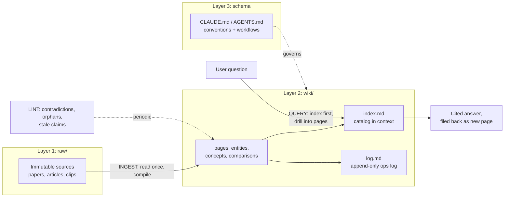

# The LLM Wiki Pattern: A Deep Research Wiki

**Compiled:** 20 September 2026 · **Scope:** origins, architecture, ecosystem, criticisms, enterprise outlook

> This repository is itself structured as an LLM wiki about the LLM Wiki pattern: `raw/sources.md` holds the immutable source list, this README plus `wiki/` hold the compiled pages, `CLAUDE.md` is the schema, and `log.md` is the append-only operation log. Charts referenced below live in the companion Drive/local copy; all figures are also given in tables.

## Executive Summary

In early April 2026, Andrej Karpathy — co-founder of OpenAI and former Director of AI at Tesla — published a GitHub Gist titled `llm-wiki.md`, describing a pattern in which an LLM **incrementally builds and maintains a persistent, interlinked markdown wiki** from raw sources, rather than re-deriving knowledge from documents on every query the way RAG does ([Atlan](https://atlan.com/know/llm-wiki-vs-rag-knowledge-base/)). The gist was deliberately not software: Karpathy called it an *idea file*, meant to be pasted into an agent such as Claude Code, Codex, or OpenCode, which then builds the concrete implementation with its user ([dev.to](https://dev.to/vishalmysore/rag-vs-agent-memory-vs-llm-wiki-a-practical-comparison-1oo6)). Within days the post chain had accumulated tens of millions of views, the gist passed 5,000 stars, and working implementations shipped inside a week ([StarMorph](https://blog.starmorph.com/blog/karpathy-llm-wiki-knowledge-base-guide), [AlphaSignal](https://x.com/AlphaSignalAI/status/2041924258147004917)).

Five months later, the pattern has matured into a full ecosystem: **more than 3,700 GitHub repositories** match the "llm wiki" search term, the flagship desktop implementation `nashsu/llm_wiki` has reached roughly **19,800 stars**, Obsidian-based packagings such as `AgriciDaniel/claude-obsidian` sit near **13,000 stars**, and Google Cloud has released the **Open Knowledge Format (OKF)**, an open specification that formalizes the same markdown-bundle philosophy for cross-vendor agent interoperability ([GitHub](https://github.com/nashsu/llm_wiki), [explainx](https://explainx.ai/blog/claude-obsidian-second-brain-obsidian-claude-code-2026), [GitBook](https://www.gitbook.com/blog/what-is-okf-open-knowledge-format)).

## 1. Origins: From a Viral Post to an "Idea File"

On April 1–2, 2026, Karpathy posted on X that a large fraction of his recent token throughput was going "less into manipulating code, and more into manipulating knowledge" — using LLMs to build personal knowledge bases stored as markdown inside Obsidian vaults ([AlphaSignal](https://x.com/AlphaSignalAI/status/2041924258147004917), [Atlan](https://atlan.com/know/llm-wiki-vs-rag-knowledge-base/)). The post hit 50,000+ likes and 16M+ views within days; VentureBeat covered the follow-up gist on April 3 under the headline that the architecture "bypasses RAG" ([StarMorph](https://blog.starmorph.com/blog/karpathy-llm-wiki-knowledge-base-guide), [VentureBeat](https://venturebeat.com/data/karpathy-shares-llm-knowledge-base-architecture-that-bypasses-rag-with-an)).

The gist opens with "This is an idea file… your agent will build out the specifics in collaboration with you," and closes by stressing it is "intentionally abstract… everything mentioned above is optional and modular" ([dev.to](https://dev.to/vishalmysore/rag-vs-agent-memory-vs-llm-wiki-a-practical-comparison-1oo6)). Much of what the community treats as "the spec" — typed ingest/lint/query commands, strict directory contracts — comes from downstream implementations, not the gist itself ([dev.to](https://dev.to/vishalmysore/rag-vs-agent-memory-vs-llm-wiki-a-practical-comparison-1oo6)).

The pattern resonated because document-chat tools are **stateless**: upload, ask, forget — nothing compounds ([DataScienceDojo](https://datasciencedojo.com/blog/llm-wiki-tutorial/)). It became practical because modern context windows (128K–1M tokens) can hold a curated personal knowledge base directly ([MindStudio](https://www.mindstudio.ai/blog/karpathy-llm-wiki-pattern-knowledge-base-without-rag)); Karpathy's own operating point is ~100 sources, a few hundred pages, ~400,000 words ([cozypet](https://cozypet.github.io/llm-wiki-schema/)).

## 2. Core Architecture: Three Layers, Three Operations, Two Files

**Layers.** (1) `raw/` — immutable sources the LLM reads but never modifies; (2) `wiki/` — LLM-generated, interlinked markdown pages (summaries, entities, concepts) with `[[wikilinks]]` and YAML frontmatter; (3) the schema — CLAUDE.md/AGENTS.md governance that "turns a generic chatbot into a disciplined wiki maintainer" ([cozypet](https://cozypet.github.io/llm-wiki-schema/)). Karpathy's formula: "Obsidian is the IDE; the LLM is the programmer; the wiki is the codebase" ([ivgraph](https://ivgraph.com/journal/what-is-llm-wiki/)).

**Operations.** *Ingest*: read source, write summary page, update index and 10–15 related pages, append to log. *Query*: answer against the wiki via the index, cite pages, file good answers back as new pages. *Lint*: periodic health checks for contradictions, stale claims, orphan pages, missing concepts ([AlphaSignal](https://x.com/AlphaSignalAI/status/2041924258147004917), [explainx](https://explainx.ai/blog/karpathy-llm-wiki-pattern-agent-memory-guide-2026)).

**Special files.** `index.md` — context-window-sized catalog with one-line summaries, the agent's entry point; `log.md` — append-only, grep-parseable operation record ([Atlan](https://atlan.com/know/llm-wiki-vs-rag-knowledge-base/), [AlphaSignal](https://x.com/AlphaSignalAI/status/2041924258147004917)). For larger wikis the gist recommends **qmd**: local hybrid BM25/vector search with LLM re-ranking, single SQLite index, fully on-device ([Karpathy gist](https://gist.github.com/karpathy/442a6bf555914893e9891c11519de94f), [infralovers](https://www.infralovers.com/blog/2026-07-28-local-knowledge-layer-instead-of-rag/)).

## 3. Why It Works: Compiler Logic and Lineage

The pattern is architecturally a **compiler**: raw sources are source code, ingest is compilation, the wiki is the intermediate representation (cross-references as symbol tables), query is linking/codegen, lint is the optimization pass — which predicts its failure modes: no optimization → bloat; no type checking → plausible-but-wrong output ([cozypet](https://cozypet.github.io/llm-wiki-schema/)). Practitioner analyses estimate up to **95% token reduction** vs naive loading and up to **70× efficiency** vs RAG pipelines at personal scale, though no published benchmark yet compares accuracy empirically ([Atlan](https://atlan.com/know/llm-wiki-vs-rag-knowledge-base/), [MindStudio](https://www.mindstudio.ai/blog/karpathy-llm-wiki-pattern-personal-knowledge-base-without-rag), [AlphaSignal](https://x.com/AlphaSignalAI/status/2041924258147004917)).

Lineage: Vannevar Bush's 1945 **Memex** (associative trails, minus the maintenance humans never sustain), Zettelkasten via **A-MEM** (arXiv:2502.12110, NeurIPS 2025; atomic notes + auto-linking + revision propagation), DeepMind's **ReadAgent** gist-memory, and a 2026 formalization paper, *Persistent Compiled Knowledge as Agent Memory* ([AlphaSignal](https://x.com/AlphaSignalAI/status/2041924258147004917), [akitaonrails/ai-memory](https://github.com/akitaonrails/ai-memory/blob/main/docs/research-karpathy-llm-wiki.md), [PaperX](https://www.youtube.com/watch?v=lkaGm7E0vxM)).

## 4. LLM Wiki vs RAG vs Agent Memory

Consensus framing: wiki and RAG answer the same question under opposite scale assumptions — wiki for **bounded, stable** corpora; RAG for **large, dynamic, multi-domain** ones. Crossover ≈ **50K–100K tokens** of compiled wiki ([Atlan](https://atlan.com/know/llm-wiki-vs-rag-knowledge-base/)).

| Dimension | LLM Wiki | RAG |
|---|---|---|
| State | Stateful, compounds ([StarMorph](https://blog.starmorph.com/blog/karpathy-llm-wiki-knowledge-base-guide)) | Stateless per query ([DataScienceDojo](https://datasciencedojo.com/blog/llm-wiki-tutorial/)) |
| Infrastructure | Markdown folder, zero pipeline | Vector DB + embeddings + chunking |
| Cross-references | Pre-built at ingest | Re-derived per query |
| Auditability | High — claims trace to files ([VentureBeat](https://venturebeat.com/data/karpathy-shares-llm-knowledge-base-architecture-that-bypasses-rag-with-an)) | Low — opaque vectors |
| Token cost/query | Low; up to ~95% less at small scale ([Atlan](https://atlan.com/know/llm-wiki-vs-rag-knowledge-base/)) | Retrieve + rerank + generate |
| Sweet spot | ~50–200 sources | Millions of documents |
| Contradictions | Flagged by lint | Coexist undetected |
| Access control / concurrency | None built in ([Atlan](https://atlan.com/know/llm-wiki-vs-rag-knowledge-base/)) | Designed for multi-user reads |

Agent memory (MemGPT/Letta, Mem0, Zep, Supermemory) is **orthogonal**: it remembers the user, not the domain ([Medium/visrow](https://medium.com/@visrow/rag-vs-agent-memory-vs-llm-wiki-a-practical-comparison-41a9a0dc4dec)). Practitioners converge on **hybrids**: wiki as the curated "what we know for sure" layer, RAG for the long tail ([MindStudio](https://www.mindstudio.ai/blog/karpathy-llm-wiki-pattern-personal-knowledge-base-without-rag)).

## 5. Ecosystem (as of 20 Sep 2026)

| Project | Form | Stars | Distinctive contribution |
|---|---|---|---|
| [nashsu/llm_wiki](https://github.com/nashsu/llm_wiki) | Tauri desktop app | **19,796** | Two-step CoT ingest, 4-signal knowledge graph, Louvain clustering, MCP server + local API, async review queue |
| [AgriciDaniel/claude-obsidian](https://github.com/AgriciDaniel/claude-obsidian) | Agent Skills + Obsidian | ~13,000 | 15 coordinated skills, transaction-safe vault writes ([explainx](https://explainx.ai/blog/claude-obsidian-second-brain-obsidian-claude-code-2026)) |
| [SamurAIGPT/llm-wiki-agent](https://github.com/SamurAIGPT/llm-wiki-agent) | Agent skill | 3,543 | Self-building KB, no API key |
| [sdyckjq-lab/llm-wiki-skill](https://github.com/sdyckjq-lab/llm-wiki-skill) | Multi-platform skill | 2,476 | Karpathy methodology, multi-platform |
| [Astro-Han/karpathy-llm-wiki](https://github.com/Astro-Han/karpathy-llm-wiki) | Agent Skills-compatible | 2,309 | Citations + linting in the skill contract |
| [atomicstrata/llm-wiki-compiler](https://github.com/atomicstrata/llm-wiki-compiler) | CLI compiler | 2,042 | Raw sources in, interlinked wiki out |
| [nvk/llm-wiki](https://github.com/nvk/llm-wiki) | Multi-agent pipeline | 1,316 | Parallel research, artifact generation |
| [kytmanov/obsidian-llm-wiki-local](https://github.com/kytmanov/obsidian-llm-wiki-local) | Local-first (Ollama) | 827 | 100% local, zero sharing |

The flagship desktop app keeps Karpathy's core (three layers, three ops, index/log, wikilinks, Obsidian compatibility) and adds the engineering a daily tool needs: SHA256 incremental ingest caching, PDF image extraction with vision captions, a four-phase query pipeline with token budgets, Deep Research auto-ingest, and a token-protected local HTTP API + MCP server ([GitHub](https://github.com/nashsu/llm_wiki)). Publishing path of choice: **Quartz** (native wikilinks, graph view, KaTeX) ([ZLHad](https://github.com/ZLHad/personal-knowledge-wiki)).

## 6. Extensions: "v2" Governance and OKF

**LLM Wiki v2** (rohitg00 gist) adds a memory lifecycle: confidence scoring, supersession chains, Ebbinghaus forgetting curves, four-tier consolidation (working → episodic → semantic → procedural) ([rohitg00](https://gist.github.com/rohitg00/2067ab416f7bbe447c1977edaaa681e2), [Rohit Ghumare](https://rohitghumare.com/blog/llm-wiki-v2/)). Long-term practitioners confirm governance features earn their place, while heavy machinery (vector search, event buses) gets ripped out — at 50K–100K tokens "grep plus read" beats embeddings ([theaioperator](https://theaioperator.io/p/karpathys-llm-wiki-v2-what-to-keep)).

**Google OKF v0.1** (June 12–13, 2026) standardizes the pattern: markdown bundles with YAML frontmatter, one required field (`type`), reserved `index.md`/`log.md`, Apache 2.0, "a format, not a platform" ([flowtivity](https://flowtivity.ai/blog/google-open-knowledge-format/), [GitBook](https://www.gitbook.com/blog/what-is-okf-open-knowledge-format)).

## 7. Criticisms and Limitations

- **"The grunt work IS the learning"** — outsourcing filing/cross-referencing may surrender the cognitive process that builds understanding; mitigation: human-in-the-loop ingest, one source at a time ([StarMorph](https://blog.starmorph.com/blog/karpathy-llm-wiki-knowledge-base-guide)).
- **Context degradation** starts around 200K–300K tokens in practice; index navigation matters more than window size ([StarMorph](https://blog.starmorph.com/blog/karpathy-llm-wiki-knowledge-base-guide)).
- **Drift/model-collapse risk** from repeated rewriting; mitigated by immutable `raw/`, lint, and git history ([StarMorph](https://blog.starmorph.com/blog/karpathy-llm-wiki-knowledge-base-guide)).
- **Complexity ceiling** at ~50–200 sources; beyond that, v2 extensions or RAG ([StarMorph](https://blog.starmorph.com/blog/karpathy-llm-wiki-knowledge-base-guide)).
- **Enterprise limits**: no access control, no transactional writes, index overflow — consequences of the personal-scale design assumptions, not bugs ([Atlan](https://atlan.com/know/llm-wiki-vs-rag-knowledge-base/)).

## 8. Enterprise Implications

"Every business has a `raw/` directory. Nobody's ever compiled it. That's the product" — and Karpathy agreed it's an "incredible new product" category ([VentureBeat](https://venturebeat.com/data/karpathy-shares-llm-knowledge-base-architecture-that-bypasses-rag-with-an)). Emerging directions: governed **context layers** (Atlan Context Agents crawling 75–100+ systems into an MCP-served repository), **multi-agent swarms with quality gates** (supervisor model scores drafts before promotion), and **fine-tuning on linted wikis** as private custom intelligence ([Atlan](https://atlan.com/know/ai-agent/data-for-ai/enterprise-knowledge-layer-for-ai/), [VentureBeat](https://venturebeat.com/data/karpathy-shares-llm-knowledge-base-architecture-that-bypasses-rag-with-an)).

## 9. Build Your Own

Minimal: an agent + a folder (`raw/`, `wiki/`, schema file) + git ([StarMorph](https://blog.starmorph.com/blog/karpathy-llm-wiki-knowledge-base-guide)). Sequence: paste gist into CLAUDE.md → scaffold → ingest one source together → query → lint after ~10 sources ([explainx](https://explainx.ai/blog/karpathy-llm-wiki-pattern-agent-memory-guide-2026)). Recommended stack: Claude Code, Obsidian, qmd (past ~500 pages), Web Clipper, Dataview, Quartz, git. Two principles: make automation **reversible** (diff notes, rollback) ([theaioperator](https://theaioperator.io/p/i-rebuilt-karpathys-llm-wiki-heres)); invest in the **schema** — it is the program, the wiki is its output ([Rohit Ghumare](https://rohitghumare.com/blog/llm-wiki-v2/)).

## 10. Outlook

In five months the pattern went from a one-page gist to a formalized agent-memory architecture, a 3,700+ repo ecosystem, packaged desktop apps, and a Google-backed standard. Its durable contribution: **agent memory should compound, not re-retrieve**. Open questions: empirical benchmarks vs RAG, multi-user governance, and the fine-tuning endgame ([AlphaSignal](https://x.com/AlphaSignalAI/status/2041924258147004917), [Atlan](https://atlan.com/know/llm-wiki-vs-rag-knowledge-base/), [VentureBeat](https://venturebeat.com/data/karpathy-shares-llm-knowledge-base-architecture-that-bypasses-rag-with-an)).
